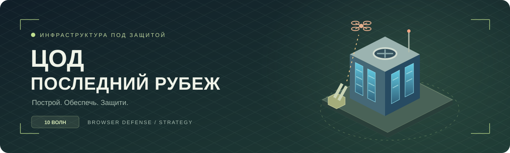

<p align="center">
  
</p>

<p align="center">
  <a href="https://github.com/1gorAn/cod-last-frontier/actions/workflows/pages.yml"></a>
  
  
  
</p>

<p align="center">
  <b>Одиночная браузерная стратегия об обороне дата-центра.</b><br />
  Серверы приносят доход. ПВО требует боеприпасов. Спутники не спрашивают разрешения на посадку.
</p>

<p align="center">
  <a href="https://1gorAn.github.io/cod-last-frontier/"><b>▶ Открыть игру</b></a>
  &nbsp; · &nbsp;
  <a href="#быстрый-старт">Запустить локально</a>
  &nbsp; · &nbsp;
  <a href="https://github.com/1gorAn/cod-last-frontier/issues">Сообщить об ошибке</a>
</p>

---

## Удержи последний рубеж

Построй базу, обеспечь питание и охлаждение, наладь доставку боекомплектов и переживи **10 волн с автоматическим переходом**. После победы выбери следующую локацию: изменятся форма карты, условия работы и финальный босс.

| Построй | Обеспечь | Защити |
| :--- | :--- | :--- |
| Развивай серверные корпуса до пятого уровня | Поддерживай энергию и охлаждение | Комбинируй специализации ПВО |
| Размещай склады, радары и мастерские | Прокладывай короткие маршруты снабжения размещением складов | Выбирай приоритеты целей |
| Планируй улучшения: здания отключаются на 8 секунд | Заказывай пополнение до полного расхода зарядов | Готовься к боссам и падающим спутникам |

### Что внутри

- **Экономика с ограниченными заказами.** Серверы зарабатывают во время боя; количество оплачиваемых заказов ограничено на каждую волну.
- **Снабжение ПВО.** Обычно у установки шесть зарядов. Машина со склада пополняет до двух ПВО за рейс и возвращается назад.
- **Две специализации.** Зенитная ПВО поражает группы, ракетная эффективна против тяжёлых целей. Можно сохранить универсальную установку.
- **Разведка.** Состав следующей волны, основное направление атаки, спутники и информация о боссе.
- **Орбитальная защита.** Спутник уничтожает сервер любого уровня. Перехватчик стоит 1000 ₽; аварийный вызов — 300 ₽, один раз за волну.
- **Развилки кампании.** После победы доступны две следующие карты и выбор оснащения базы с преимуществом и недостатком.
- **Живое окружение.** Леса, реки, скалы, снег, заросшие руины, птицы, животные и рябь на воде.
- **События с юмором.** Неожиданные сообщения, редкий бочколёт и ускорение «на честном слове».

## Локации и боссы

| Локация | Условия | Босс десятой волны |
| :--- | :--- | :--- |
| Сосновый бор | Просторная стартовая площадка, стандартные условия | **Лесной улей** — носитель минидронов |
| Заросший периметр | Меньше места; охлаждение +15%, доставка −10% | **Лесной улей** — выпускает по три минидрона |
| Красный каньон | Узкая перемычка; энергия +15%, охлаждение −10% | **Бастион** — броня и ракетные залпы |
| Островной узел | Вода и сухопутные перемычки; охлаждение +20%, энергия −10% | **Глушитель** — уменьшает дальность ПВО рядом с собой |
| Полярная станция | Компактная площадка; охлаждение +30%, доставка −20% | **Полярный импульс** — замедляет перезарядку ПВО |
| Старый комплекс | Завалы; ремонт дешевле на 25%, энергия −10% | **Регенератор** — восстанавливает здоровье |

Награда за победу пополняет ресурсы следующей базы. Сама база строится заново, а условия и награды следующего рубежа видны до перехода.

### Особые гости

**Бочколёт** — редкий бронированный самолёт с ракетами. Может появиться с четвёртой волны; если не прилетел раньше, появится на девятой.

**«Свин»** — наземный мех с анимациями движения, атаки и уничтожения. С пятой волны обходит непроходимые клетки, подходит к зданиям и стреляет перехватываемыми ракетами. С восьмой волны их уже двое.

## Управление

| Действие | Как выполнить |
| :--- | :--- |
| Построить объект | Выбрать в каталоге → нажать на свободную доступную клетку |
| Улучшить, отремонтировать, настроить ПВО | Нажать на здание |
| Заказать боеприпасы | Выбрать ПВО → «Заказать пополнение» |
| Посмотреть маршрут снабжения | Выбрать склад, обслуживаемое ПВО или грузовик |
| Переместить камеру | Перетаскивание карты |
| Изменить масштаб | Колесо мыши, жест двумя пальцами или кнопки + / − |
| Отменить выбор / строительство | `Esc` или кнопка отмены |
| Поставить на паузу в любой момент | `Пробел` или кнопка паузы |
| Открыть каталог на телефоне | Кнопка «Строить» |
| Включить звуковые предупреждения | Кнопка с нотой; громкость — в настройках |

> После запуска атака идёт непрерывно до победы или поражения. Пробел и кнопка паузы останавливают бой; служебные окна также приостанавливают симуляцию. На паузе можно строить. Поражение наступает при потере всех серверов или падении репутации до нуля.

## Быстрый старт

Нужны **Node.js 22.23+** и npm.

```bash
git clone https://github.com/1gorAn/cod-last-frontier.git
cd cod-last-frontier
npm ci
npm run dev
```

Открой адрес, который напечатает Vite, с путём `/cod-last-frontier/` — обычно это [localhost:5173/cod-last-frontier/](http://localhost:5173/cod-last-frontier/).

| Команда | Назначение |
| :--- | :--- |
| `npm run dev` | Локальный сервер разработки |
| `npm test` | Тесты симуляции, экономики, боёв, карт и сохранений |
| `npm run build` | Проверка TypeScript и сборка в `dist/` |
| `npm run preview` | Локальный просмотр готовой сборки |

## Публикация на GitHub Pages

В проекте настроен [workflow публикации](.github/workflows/pages.yml): push в `main` запускает установку зависимостей, тесты, сборку и развёртывание `dist/`.

1. Открой **Settings → Pages** в репозитории.
2. В **Build and deployment → Source** выбери **GitHub Actions**.
3. Открой **Actions → Publish game to GitHub Pages** и дождись успешного завершения. При необходимости используй **Run workflow**.

Адрес публикации: **https://1gorAn.github.io/cod-last-frontier/**.

Для размещения под другим именем репозитория измени `base` в [vite.config.ts](vite.config.ts). Серверная часть и API-ключи для игры не нужны.

## Сохранения

Прогресс автоматически сохраняется в браузере каждые пять секунд. В настройках доступны сохранение вручную, экспорт и импорт JSON.

Сохранения привязаны к браузеру и адресу сайта. Для переноса из локальной версии на GitHub Pages или на другое устройство экспортируй файл и импортируй его в новой версии.

## Устройство проекта

```text
src/
├── model.ts        # Симуляция, экономика, бой и сохранения
├── scene.ts        # Карта, спрайты, анимации и управление камерой
├── main.tsx        # Интерфейс React
├── session.ts      # Сессия и автосохранение
├── maps.ts         # Локации, доступные клетки и маршруты
├── bosses.ts       # Типы и характеристики боссов
├── environment.ts  # Природное окружение
├── art.ts          # Кадры спрайт-листов
├── alerts.ts       # Звуковые предупреждения
└── style.css       # Адаптивное оформление
public/assets/      # Игровая графика
tests/              # Тесты модели
.github/workflows/  # Автоматическая публикация
```

---

<p align="center"><b>Держи серверы холодными, склады целыми, а небо — чистым.</b></p>

Первая локация даёт время освоиться: интервал появления врагов увеличен на 20%, урон по зданиям снижен на 15% (кроме спутников), между волнами есть 6 секунд на снабжение. До старта атаки перегрев и нехватка энергии не разрушают базу. После каждой успешной постройки здание нужно выбрать заново.
